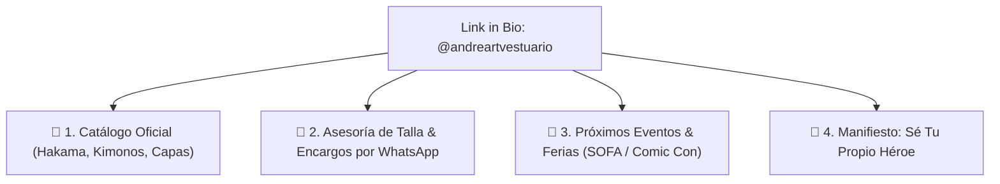

# Optimización de Biografía y Perfil de Instagram: @andreartvestuario

> [!NOTE]
> **Resumen Ejecutivo:** Auditoría y propuesta estratégica de reestructuración para el encabezado y la biografía del perfil oficial de Instagram de **Andreart Vestuario** ([`@andreartvestuario`](https://www.instagram.com/andreartvestuario)), orientada a corregir la infracción de vocabulario ("geek"), eliminar erratas ortográficas ("contaco"), potenciar el SEO de búsqueda en Instagram y elevar el posicionamiento a **Moda Urban Fantasy y Diseño de Autor**.

---

## 🎯 Contexto y Diagnóstico del Perfil Actual

### 📊 Análisis del Encabezado Actual (Captura Auditoría)
- **Nombre de Usuario:** `@andreartvestuario`
- **Nombre de Perfil (Campo Name):** `AndreART`
- **Biografía Actual:**
  ```text
  🧵 Moda geek hecha en 🇨🇴
  🪡 Prendas con historia propia
  👩‍🎨 Hechas por mujeres
  📦 Envíos nacionales
  👇 Catálogo, eventos y contaco
  ```
- **Enlace Principal (Link in Bio):** `andreart.cercia.co`

### ⚠️ Puntos Críticos a Corregir

1. **Infracción del Manual de Tono y Vocabulario (Uso de "Geek"):**
   - El uso de la palabra *"geek"* contradice el manual de tono y voz de la marca, el cual prohíbe expresamente los términos *"geek"*, *"nerd"* o *"disfraz"*, reemplazándolos por **Moda Urban Fantasy**, **Indumentaria Conceptual** o **Diseño de Autor**.
2. **Error Tipográfico / Ortográfico:**
   - La palabra final dice `"contaco"` en lugar de `"contacto"`.
3. **Falta del Eslogan Oficial de Marca:**
   - No aparece el eslogan transversal: **"Sé tu propio héroe"** 🛡️, el cual genera conexión emocional inmediata.
4. **Suboptimización del Campo Nombre (SEO de Instagram):**
   - El campo Nombre sólo dice `AndreART`. Al poner palabras clave como `Moda Urban Fantasy` o `Diseño de Autor`, la marca aparecerá en los primeros resultados cuando los usuarios busquen esos términos en Instagram.
5. **Omisión de la Moldería Inteligente (XS a XL):**
   - No se menciona una de las mayores fortalezas técnicas de las prendas: su moldería adaptable multitalla unisex.

---

## 📋 Propuestas Estratégicas de Bio

---

### 👑 OPCIÓN 1: Posicionamiento de Autor & Eslogan Maestro (RECOMENDADA)

Esta opción equilibra el posicionamiento estético, la moldería inteligente y el eslogan oficial de la marca.

```text
Nombre: Andreart | Moda Urban Fantasy 🇨🇴

Biografía:
✨ Moda Urban Fantasy & Diseño de Autor
📐 Moldería inteligente unisex (XS a XL)
🪡 Confección de autor hecha en Bogotá 🇨🇴
🛡️ "Sé tu propio héroe"
👇 Catálogo oficial, ferias y pedidos:
```

- **Por qué funciona:**
  - El nombre incluye `Moda Urban Fantasy 🇨🇴` para posicionar en el buscador de Instagram.
  - Elimina el término "geek" y lo eleva a *Diseño de Autor*.
  - Destaca el sistema de tallas versátil (XS-XL).
  - Incluye el eslogan institucional entre comillas y emojis limpios.
  - Corrige el typo de "contacto" por una llamada a la acción clara.

---

### ⚔️ OPCIÓN 2: Enfocada en Narrativa & Universos Épicos

Diseñada para conectar con la comunidad que ama las referencias culturales de literatura, cine y animación contemporánea.

```text
Nombre: Andreart Vestuario | Diseño de Autor

Biografía:
⚔️ Indumentaria conceptual de autor
📐 Prendas atemporales con moldería adaptable (XS-XL)
🇨🇴 Alta confección hecha en Bogotá
📦 Envíos a toda Colombia
👇 Explora el catálogo y haz tu pedido:
```

- **Por qué funciona:**
  - Mantiene un tono atemporal, elegante y directo.
  - Reemplaza "prendas con historia propia" por *indumentaria conceptual de autor*.
  - Enfatiza los envíos nacionales y la compra rápida.

---

### 🛍️ OPCIÓN 3: Orientada a Conversión Directa E-Commerce / WhatsApp

Enfocada en maximizar el clic hacia la tienda virtual o el chat de WhatsApp.

```text
Nombre: Andreart | Indumentaria Conceptual

Biografía:
👘 Hakamas, Kimonos & Capas de autor
📐 Moldería adaptable unisex (XS a XL)
🪡 Taller de confección en Bogotá 🇨🇴
🛡️ "Sé tu propio héroe"
👇 Compra directa y asesoría por WhatsApp:
```

- **Por qué funciona:**
  - Menciona directamente las prendas héroe más deseadas (*Hakamas*, *Kimonos*, *Capas*).
  - Orienta al cliente a pedir asesoría directa de talla por WhatsApp.

---

## 🔗 Estructuración Sugerida del Enlace (Link in Bio)

Se recomienda que el enlace (`andreart.cercia.co` o Linktree/Sitio Web) despliegue de 3 a 4 botones clave con jerarquía clara:



---

## 🔄 Historial de Revisiones (Changelog)
- **v1.0 (2026-08-09):** Auditoría del perfil actual de Instagram, corrección de infracción de vocabulario ("geek"), eliminación de errores ortográficos y creación de 3 opciones optimizadas de biografía.

---

## 🧪 Próximos Pasos Recomendados
- [ ] Seleccionar una de las 3 opciones de bio propuestas.
- [ ] Actualizar el campo **Nombre** y **Biografía** en la configuración de Instagram.
- [ ] Revisar el enlace `andreart.cercia.co` para garantizar que los botones principales estén ordenados por prioridad comercial.

---

## 🔗 Referencias Cruzadas
- Canales Oficiales y Redes Sociales: [[01 Brand Context/Canales Oficiales y Redes Sociales.md]]
- Manual de Tono y Voz de Marca: [[01 Brand Context/Tone and Voice.md]]
- Contexto de Producto Maestro: [[01 Brand Context/product-marketing-context.md]]
