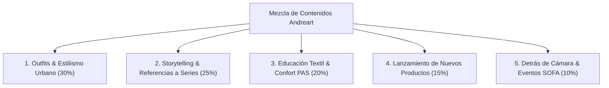
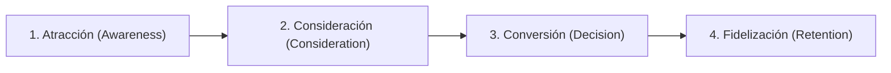

# Master Content Strategy: Andreart Vestuario

*Estrategia Integral de Contenido Searchable & Shareable para E-Commerce, Blog y Redes Sociales*
*Folder: 02 Strategy & Research / Content Strategy*
*Last updated: 2026-08-09*

> 🛡️ **Eslogan Oficial de Marca:** *"Sé tu propio héroe"*

---

## 📌 Índice de Contenidos

- [1. Marco General & Alineación de Negocio](#1-marco-general--alineación-de-negocio)
- [2. Matriz de los 5 Tipos de Publicaciones (Content Mix)](#2-matriz-de-los-5-tipos-de-publicaciones-content-mix)
- [3. Matriz de Contenido Searchable vs. Shareable](#3-matriz-de-contenido-searchable-vs-shareable)
- [4. Mapeo de Contenidos por Etapa del Comprador (Buyer Journey)](#4-mapeo-de-contenidos-por-etapa-del-comprador-buyer-journey)
- [5. Estrategia por Canal & Redes Sociales](#5-estrategia-por-canal--redes-sociales)
- [6. Plan de Ejecución & Hoja de Ruta](#6-plan-de-ejecución--hoja-de-ruta)

---

## 1. MARCO GENERAL & ALINEACIÓN DE NEGOCIO

### 1.1 Propósito Estratégico
Establecer la hoja de ruta de contenidos para posicionar a **Andreart Vestuario** como la marca líder indiscutible en Colombia de **Moda Urban Fantasy y Diseño de Autor**, conectando con profesionales y creativos amantes del anime, el cine y la literatura de ficción.

### 1.2 Atributos del Producto & Propuesta de Valor
- **Categoría Reclamada:** Moda Urban Fantasy de Autor (Indumentaria Conceptual).
- **Diseñadora Principal:** Andrea (diseño original y confección ética en Bogotá).
- **Atributos Clave:** Siluetas deconstruidas (Hakamas, Haoris, Capas, Kimonos), moldería inteligente multitalla sin género (XS a XL), textiles de alta densidad y confort PAS (marquillas estampadas imperceptibles).
- **Tono Comercial:** Simple, claro, asertivo, firme y orientado al cierre de ventas con el eslogan *"Sé tu propio héroe"*.

---

## 2. MATRIZ DE LOS 5 TIPOS DE PUBLICACIONES (CONTENT MIX)

Para evitar que la presencia digital se limite a un "catálogo estático de ventas", toda la producción de contenidos se distribuye en **5 Tipos de Publicaciones complementarias**:

---

### TIPO 1: Outfits & Estilismo Urbano (30% de la Producción)
- **Objetivo:** Enseñar al cliente cómo combinar prendas de autor (Hakamas, Haoris, Capas, Kimonos) con ropa básica cotidiana en entornos reales (oficina tech/salud/BPO, citas, reuniones y salidas nocturnas).
- **Ángulos de Contenido:**
  - *"3 formas de llevar un Pantalón Hakama a la oficina sin parecer disfraz."*
  - *"Outfit de viernes en la noche: Haori Urbano + jeans oscuros + botines de cuero."*
  - *"Cómo elevar una camiseta lisa neutra agregando un Kimono de autor."*

---

### TIPO 2: Storytelling & Referencias a Series/Anime (25% de la Producción)
- **Objetivo:** Conectar emocionalmente con la comunidad a través de referencias culturales reconocibles (*Jujutsu Kaisen*, *Demon Slayer*, *Star Wars*, *Dune*, *Cyberpunk Edgerunners*, *Attack on Titan*, *House of the Dragon*).
- **Ángulos de Contenido:**
  - *"Vístete con la actitud de un Hechicero de Jujutsu Kaisen en la ciudad (Pantalón Hakama)."*
  - *"La mística de un Guardián Galáctico traída a tu abrigo de invierno (Capa de Mago)."*
  - *"Estilo Nightlife inspirado en Cyberpunk Edgerunners (Haori Urbano)."*

---

### TIPO 3: Educación Textil & Confort PAS (20% de la Producción)
- **Objetivo:** Demostrar la calidad técnica de autor y resolver las principales objeciones de compra (tallas, textura, durabilidad).
- **Ángulos de Contenido:**
  - *"Por qué tus prendas Andreart jamás van a picas (Marquillas estampadas - Cuidado PAS)."*
  - *"Test de caída pesada y densidad: Tela de autor vs. Poliéster delgado de fast-fashion."*
  - *"Demostración multitalla: Cómo una sola pieza abraza con elegancia de la talla XS a la XL."*

---

### TIPO 4: Lanzamiento de Nuevos Productos (15% de la Producción)
- **Objetivo:** Dar a conocer las prendas recién creadas en el taller con narrativa de autor y llamados a la compra directa.
- **Ángulos de Contenido:**
  - *"REVELACIÓN: Nueva Prenda de Autor [Nombre del Producto]."*
  - *"Detalles que enamoran: Primer plano de costuras, broches y caídas de la nueva prenda."*
  - *"Anuncio de tanda limitada cortada a mano en Bogotá."*

---

### TIPO 5: Detrás de Cámara & Eventos (SOFA/ComicCon) (10% de la Producción)
- **Objetivo:** Generar confianza, autenticidad y expectativa para eventos presenciales.
- **Ángulos de Contenido:**
  - *"Un día en el taller de Andreart: Sonidos ASMR de tijera, tiza y vapor."*
  - *"Construyendo el portal de entrada para nuestro stand en SOFA 2026."*
  - *"Del boceto digital de Andrea a la tela cortada en el mesón."*

---

## 3. MATRIZ DE CONTENIDO SEARCHABLE VS. SHAREABLE

### 3.1 Contenido Searchable (Captura de Demanda Existente - Web & SEO)
Contenido optimizado para personas que buscan activamente soluciones en Google:

| Keyword / Búsqueda | Tipo de Contenido | Formato | Etapa del Comprador |
|---|---|---|---|
| *"Pantalón Hakama Colombia"* | Ficha de Producto + Guía de Estilismo | Página E-Commerce | Decision / Transaccional |
| *"Ropa estilo Haori para hombre/mujer"* | Ficha de Producto | Página E-Commerce | Decision / Transaccional |
| *"Capas de abrigo elegantes Bogotá"* | Artículo de Blog / Guía | Blog Web | Consideration / Comercial |
| *"Moda alternativa de autor Bogotá"* | Página de Categoría | E-Commerce Hub | Awareness / Informacional |
| *"Ropa inspirada en anime sin parecer disfraz"* | Artículo de Blog | Blog Web | Consideration / Comercial |

### 3.2 Contenido Shareable (Creación de Demanda - Instagram & TikTok)
Contenido diseñado para generar sorpresa, identificación y viralidad en redes sociales:

| Concepto / Idea | Formato | Plataforma | Disparador de Compartir |
|---|---|---|---|
| *"Basta de vestirte de aburrimiento en la oficina. Hakama de autor vs. Ropa genérica."* | Reel Corto (15-30s) | Instagram / TikTok | Identificación con la libertad de estilo. |
| *"3 outfits inspirados en sagas de culto para salir de fiesta el fin de semana."* | Carrusel / Reel | Instagram | Valor práctico + Estética envolvente. |
| *"Prueba de la etiqueta fantasma: Ropa amigable con pieles hiper-sensibles PAS."* | Video Demostrativo | TikTok / Instagram | Utilidad para comunidad PAS / Neurodivergente. |

---

## 4. MAPEO DE CONTENIDOS POR ETAPA DEL COMPRADOR (BUYER JOURNEY)

### Etapa 1: Atracción (Awareness)
- **Formato:** Reels dinámicos, TikToks de transición y publicaciones con referencias a anime/cine (Tipos 2 y 5).
- **Mensaje:** *"No naciste para vestir ropa aburrida. Descubre la indumentaria Urban Fantasy de autor."*

### Etapa 2: Consideración (Consideration)
- **Formato:** Carruseles de estilismo urbano, pruebas de moldería multitalla (XS a XL) y confort PAS (Tipos 1 y 3).
- **Mensaje:** *"Moldería inteligente que se adapta a tu cuerpo sin etiquetas que pican. Diseñado para usar en la oficina y de fiesta."*

### Etapa 3: Conversión (Decision)
- **Formato:** Publicaciones de nuevos productos con copy comercial asertivo, enlaces directos a la tienda web y atención en WhatsApp (Tipo 4).
- **Mensaje:** *"Pide el tuyo hoy con envío rápido a todo Colombia. Elige tu prenda y viste con la actitud que mereces."*

### Etapa 4: Fidelización (Retention)
- **Formato:** Mensajes de seguimiento en WhatsApp, adelantos exclusivos de nuevas colecciones y atención personalizada.
- **Mensaje:** *"Gracias por ser parte de la comunidad Andreart. Sé tu propio héroe."*

---

## 5. ESTRATEGIA POR CANAL & REDES SOCIALES

### 5.1 Instagram (`@andreartvestuario`)
- **Frecuencia Sostenible:** 2 publicaciones por semana en el feed (8 publicaciones al mes) + historias ligeras complementarias.
- **Enfoque:** Combinar los 5 tipos de contenido en la grilla mensual para mantener dinamismo sin sobrecargar la producción del taller.

### 5.2 TikTok
- **Frecuencia:** 1 a 2 videos semanales (reutilizando y adaptando las tomas de los Reels de Instagram).
- **Enfoque:** Videos de transformación de outfit, detrás de cámara en el taller y humor de nicho respetuoso.

### 5.3 Blog & E-Commerce D2C
- **Frecuencia:** 2 artículos mensuales orientados a SEO (guías de estilismo urbano y moda alternativa).
- **Enfoque:** Tráfico orgánico de alta intención de compra.

---

## 6. PLAN DE EJECUCIÓN & HOJA DE RUTA

1. **Fase 1 (Semana 1):** Calendario de contenidos de las primeras 2 semanas aplicando la mezcla de los 5 tipos.
2. **Fase 2 (Semana 2):** Optimización SEO de fichas de producto web con las palabras clave objetivo.
3. **Fase 3 (Semana 3-4):** Producción del primer lote de contenidos shareables y lanzamiento de la parrilla continua.
