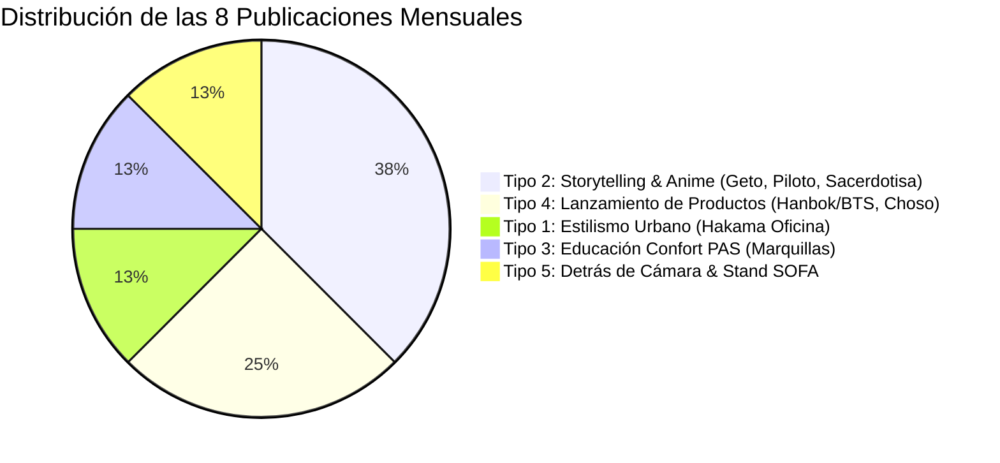

# Calendario Mensual de Publicaciones para Instagram (2 Posts / Semana)

*Matriz Mensual Sostenible de 8 Publicaciones Organizada por Semanas*
*Location: 07 Paid, Social & Community / Social Content*
*Last updated: 2026-08-09*

> 🛡️ **Eslogan Oficial de Marca:** *"Sé tu propio héroe"*

---

## 📌 Navegación & Referencias Cruzadas

- 📘 **Estrategia Maestra de Contenidos:** [[02 Strategy & Research/Content Strategy/Master Content Strategy.md]]
- 🛠️ **Guía Técnica de Producción (SOP):** [[07 Paid, Social & Community/Social Content/Guia Tecnica de Produccion de Contenido.md]]
- 💡 **Banco de Ideas por Tipo de Publicación:** [[02 Strategy & Research/Marketing Ideas/Ideas de Contenido por Tipo de Publicacion.md]]

---

## 🗓️ TABLA MAESTRA MENSUAL REALISTA (8 PUBLICACIONES / 2 POR SEMANA)

| Día Sugerido         | Semana   | Tipo de Publicación                    | Prenda / Concepto         | Gancho Principal (Hook)                                                           | Subtexto (CTA)                                                                                | Texto Alt (SEO & Accesibilidad)                                                                                       | Hashtags                                                                                                                            | Copy Completo (Listo para Copiar)                                                                                                                                                                                                                                                                                                             | Formato Visual    | Estado         | ¿Publicado? | Link Publicación                         |
| -------------------- | -------- | -------------------------------------- | ------------------------- | --------------------------------------------------------------------------------- | --------------------------------------------------------------------------------------------- | --------------------------------------------------------------------------------------------------------------------- | ----------------------------------------------------------------------------------------------------------------------------------- | --------------------------------------------------------------------------------------------------------------------------------------------------------------------------------------------------------------------------------------------------------------------------------------------------------------------------------------------- | ----------------- | -------------- | ----------- | ---------------------------------------- |
| **Domingo (Día 02)** | Semana 1 | **Tipo 4:** Lanzamiento Contextual     | **Hanbok Reinterpretado** | *"El outfit perfecto y elegante para el próximo concierto de BTS ya está aquí."*  | 👉 Pide el tuyo en el link de la bio o escríbenos por DM antes de agotar la tanda del taller. | *Fotografía de moda mostrando un Hanbok reinterpretado en Jeogori negro y falda morada jacquard sobre fondo urbano.*  | `#Andreart #ModaDeAutor #UrbanFantasy #BogotaModa #SeTuPropioHeroe #HanbokUrbano #BTSColombia #KpopBogota #BTSOutfit`               | `El outfit perfecto y elegante para el próximo concierto de BTS ya está aquí.  👉 Pide el tuyo en el link de la bio o escríbenos por DM antes de agotar la tanda del taller.  Sé tu propio héroe. 🛡️  #Andreart #ModaDeAutor #UrbanFantasy #BogotaModa #SeTuPropioHeroe #HanbokUrbano #BTSColombia #KpopBogota #BTSOutfit` | Reel + Carrusel   | 🟢 Listo       | [x]         | https://www.instagram.com/p/Db1e9wUDYrV/ |
| **Viernes (Día 05)** | Semana 1 | **Tipo 1:** Estilismo Urbano           | **Pantalón Hakama**       | *"3 formas de llevar tu Hakama a la oficina sin parecer disfraz."*                | 👉 Guarda este carrusel para tu próximo outfit y pide el tuyo en el enlace de la bio.         | *Pantalón Hakama unisex de corte ancho combinando estilismo samurái urbano con blazer casual de oficina.*             | `#Andreart #ModaDeAutor #UrbanFantasy #HakamaUrbano #SamuraiUrbano #OficinaTech #EstilismoUrbano #SeTuPropioHeroe`                  | `3 formas de llevar tu Hakama a la oficina sin parecer disfraz.  👉 Guarda este carrusel para tu próximo outfit y pide el tuyo en el enlace de la bio.  Sé tu propio héroe. 🛡️  #Andreart #ModaDeAutor #UrbanFantasy #HakamaUrbano #SamuraiUrbano #OficinaTech #EstilismoUrbano #SeTuPropioHeroe`                          | Carrusel (4 pág)  | 📝 Planificado | [ ]         | *(Sin link)*                             |
| **Martes (Día 09)**  | Semana 2 | **Tipo 2:** Storytelling Anime         | **Suguru Geto**           | *"Camina por la ciudad con la presencia imponente de Suguru Geto."*               | 👉 Comenta 'GETO' para enviarte la ficha técnica y disponibilidad por mensaje directo.        | *Chaqueta y silueta de autor inspirada en Suguru Geto de Jujutsu Kaisen con caída pesada y abrigo oscuro urbano.*     | `#Andreart #ModaDeAutor #UrbanFantasy #BogotaModa #SeTuPropioHeroe #SuguruGeto #JujutsuKaisenColombia #AnimeFashion #CosplayUrbano` | `Camina por la ciudad con la presencia imponente de Suguru Geto.  👉 Comenta 'GETO' para enviarte la ficha técnica y disponibilidad por mensaje directo.  Sé tu propio héroe. 🛡️  #Andreart #ModaDeAutor #UrbanFantasy #BogotaModa #SeTuPropioHeroe #SuguruGeto #JujutsuKaisenColombia #AnimeFashion #CosplayUrbano`       | Reel (15-20s)     | 📝 Borrador    | [ ]         | *(Sin link)*                             |
| **Viernes (Día 12)** | Semana 2 | **Tipo 3:** Educación Confort PAS      | **Marquilla Estampada**   | *"Si tienes piel sensible, esta marquilla te va a cambiar la vida."*              | 👉 Descubre el confort PAS en nuestra tienda web. Enlace directo en la bio.                   | *Acercamiento macro a la marquilla estampada suave sin costuras ni etiquetas molestas sobre tela de algodón peruano.* | `#Andreart #ModaDeAutor #ConfortPAS #PielSensible #BogotaModa #SeTuPropioHeroe #RopaSinEtiquetas #SensibilidadTactil`               | `Si tienes piel sensible, esta marquilla te va a cambiar la vida.  👉 Descubre el confort PAS en nuestra tienda web. Enlace directo en la bio.  Sé tu propio héroe. 🛡️  #Andreart #ModaDeAutor #ConfortPAS #PielSensible #BogotaModa #SeTuPropioHeroe #RopaSinEtiquetas #SensibilidadTactil`                               | Reel Demostrativo | 📝 Planificado | [ ]         | *(Sin link)*                             |
| **Martes (Día 16)**  | Semana 3 | **Tipo 2:** Storytelling Sci-Fi        | **Chaqueta de Piloto**    | *"Siente la mística de un Piloto Galáctico en tu abrigo de todos los días."*      | 👉 Pide tu Chaqueta de Piloto en la web antes de cerrar pedidos del mes.                      | *Chaqueta de abrigo de autor inspirada en escuadrones de cazas galácticos con detalles de moldería técnica.*          | `#Andreart #ModaDeAutor #UrbanFantasy #StarWarsColombia #ChaquetaPiloto #SciFiFashion #SeTuPropioHeroe #BogotaModa`                 | `Siente la mística de un Piloto Galáctico en tu abrigo de todos los días.  👉 Pide tu Chaqueta de Piloto en la web antes de cerrar pedidos del mes.  Sé tu propio héroe. 🛡️  #Andreart #ModaDeAutor #UrbanFantasy #StarWarsColombia #ChaquetaPiloto #SciFiFashion #SeTuPropioHeroe #BogotaModa`                            | Reel + Fotos      | 📝 Planificado | [ ]         | *(Sin link)*                             |
| **Viernes (Día 19)** | Semana 3 | **Tipo 4:** Lanzamiento de Producto    | **Choso**                 | *"Llegó la prenda inspirada en la intensidad y nobleza de Choso."*                | 👉 Edición limitada. Escribe 'CHOSO' por DM para reservar tu talla.                           | *Prenda de autor con la silueta mística e intensa inspirada en Choso de Jujutsu Kaisen.*                              | `#Andreart #ModaDeAutor #UrbanFantasy #ChosoJujutsuKaisen #JujutsuKaisen #SeTuPropioHeroe #AnimeBogota`                             | `Llegó la prenda inspirada en la intensidad y nobleza de Choso.  👉 Edición limitada. Escribe 'CHOSO' por DM para reservar tu talla.  Sé tu propio héroe. 🛡️  #Andreart #ModaDeAutor #UrbanFantasy #ChosoJujutsuKaisen #JujutsuKaisen #SeTuPropioHeroe #AnimeBogota`                                                       | Reel Revelación   | 📝 Planificado | [ ]         | *(Sin link)*                             |
| **Martes (Día 23)**  | Semana 4 | **Tipo 2:** Mística Oriental           | **Sacerdotisa Sintoísta** | *"La serenidad y mística del templo oriental traducida en moda urbana de autor."* | 👉 Compra la prenda en la tienda web con envíos a toda Colombia.                              | *Conjunto urbano de autor reinterpretando la estética tradicional de sacerdotisa sintoísta en clave moderna.*         | `#Andreart #ModaDeAutor #UrbanFantasy #SacerdotisaSintoista #MisticaOriental #ModaJaponesa #SeTuPropioHeroe`                        | `La serenidad y mística del templo oriental traducida en moda urbana de autor.  👉 Compra la prenda en la tienda web con envíos a toda Colombia.  Sé tu propio héroe. 🛡️  #Andreart #ModaDeAutor #UrbanFantasy #SacerdotisaSintoista #MisticaOriental #ModaJaponesa #SeTuPropioHeroe`                                      | Carrusel Estético | 📝 Planificado | [ ]         | *(Sin link)*                             |
| **Viernes (Día 26)** | Semana 4 | **Tipo 5:** Detrás de Cámara & Eventos | **ASMR Taller + Stand**   | *"15 segundos de satisfacción pura cortando tela en nuestro taller."*             | 👉 Apoya el diseño de autor hecho en Bogotá guardando y compartiendo este Reel.               | *Tijera profesional de confección cortando tela textil pesada sobre la mesa de patronaje del taller en Bogotá.*       | `#Andreart #ModaDeAutor #TallerBogota #ASMRTextil #ConfeccionEtica #DiseñoColombiano #SeTuPropioHeroe #Craftsmanship`               | `15 segundos de satisfacción pura cortando tela en nuestro taller.  👉 Apoya el diseño de autor hecho en Bogotá guardando y compartiendo este Reel.  Sé tu propio héroe. 🛡️  #Andreart #ModaDeAutor #TallerBogota #ASMRTextil #ConfeccionEtica #DiseñoColombiano #SeTuPropioHeroe #Craftsmanship`                          | Reel ASMR / Vlog  | 📝 Planificado | [ ]         | *(Sin link)*                             |

---

## 📊 DISTRIBUCIÓN DEL RITMO SOSTENIBLE (2 POSTS / SEMANA)

---

## 📱 ESTRATEGIA DE HISTORIAS DIARIAS (COMPLEMENTO LIGERO)

Para mantener la cuenta activa entre los 2 posts semanales principales sin sobrecargarse de grabación:
- **Lunes:** Encuesta simple en historias (*"¿Cuál es tu saga favorita del mes?"*).
- **Miércoles:** Foto rápida de prenda o tela en taller + link a la tienda web.
- **Sábado:** Recompartir foto de cliente luciendo una prenda o recordatorio de envío nacional.

---

## 🔗 RECURSOS Y ENLACES INTERNOS

- **Script de Generación de Post:**  
  `bash MarketingAgentCore/scripts/create-social-post.sh instagram "<idea>" [tipo] [ref] [prenda]`
- **Guía Directorial por Escena (SOP de Rodaje):**  
  [[07 Paid, Social & Community/Social Content/Guia Tecnica de Produccion de Contenido.md#3-guía-directorial-de-rodaje--requerimientos-técnicos-por-escena]]
- **Guión Generado de ASMR:**  
  [[07 Paid, Social & Community/Social Content/2026-08-08-instagram-asmr-sonido-de-la-tijera-y-corte-de-tela-pesada-de-autor.md]]
