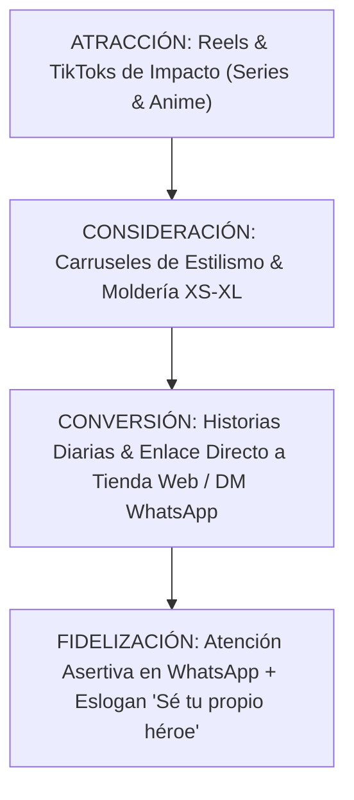

# Propuesta Estratégica de Redes Sociales: Andreart Vestuario

*Plan Maestro de Posicionamiento, Generación de Demanda y Conversión E-Commerce*
*Last updated: 2026-08-08*

---

## 📌 Índice de Contenidos

- [1. Objetivo Estratégico & Diagnóstico](#1-objetivo-estratégico--diagnóstico)
- [2. Matriz de Canales & Roles de Redes Sociales](#2-matriz-de-canales--roles-de-redes-sociales)
- [3. Los 4 Pilares de Contenido](#3-los-4-pilares-de-contenido)
- [4. Formatos, Frecuencia y Calendario Semanal](#4-formatos-frecuencia-y-calendario-semanal)
- [5. Embudo de Conversión (De Visualización a Venta Web/WhatsApp)](#5-embudo-de-conversión-de-visualización-a-venta-webwhatsapp)
- [6. Plan de Acción & Siguientes Pasos](#6-plan-de-acción--siguientes-pasos)

---

## 1. OBJETIVO ESTRATÉGICO & DIAGNÓSTICO

### 1.1 Meta Principal
Transformar la presencia digital de **Andreart Vestuario** en Instagram (`@andreartvestuario`) y TikTok en un **motor de generación de demanda y conversión e-commerce directa**, posicionando a la marca en Colombia como la referente indiscutible de **Moda Urban Fantasy y Diseño de Autor**.

### 1.2 El Giro de Enfoque
Pasar de una vitrina de fotos de producto estáticas a un **canal de entretenimiento estético y comercial asertivo** que:
- Conecte emocionalmente con los amantes del anime de culto, la ciencia ficción y las sagas de fantasía a través de referencias culturales directas.
- Muestre la versatilidad de vestir siluetas de autor (Hakamas, Haoris, Capas, Kimonos) en el día a día (trabajo, oficina) y salidas de noche/fiestas.
- Cierre ventas con mensajes asertivos e impulsos al canal digital D2C (Web y WhatsApp) bajo el eslogan: **"Sé tu propio héroe"**.

---

## 2. MATRIZ DE CANALES & ROLES DE REDES SOCIALES

| Canal | Rol Estratégico | Formatos Clave | Objetivo de Conversión |
|---|---|---|---|
| 📸 **Instagram (@andreartvestuario)** | **Canal Principal de Marca & Conversión** | Reels, Carruseles de estilismo, Historias diarias | Tráfico al e-commerce, DMs de compra y posicionamiento de marca. |
| 🎵 **TikTok** | **Alcance Orgánico & Viralidad de Nicho** | Videos cortos (15-45s) de outfits, humor de nicho y detrás de cámara | Construcción de audiencia, awareness nacional y tráfico a Instagram/Web. |
| 💬 **WhatsApp Business** | **Canal de Cierre Comercial Directo** | Asesoría en chat, catálogos, estados de inventario | Cierre de ventas, dudas de talla (XS-XL) y fidelización de clientes. |

---

## 3. LOS 4 PILARES DE CONTENIDO

---

### PILAR 1: Outfits & Estilismo Urbano (40% del Contenido)
- **Concepto:** Demostración práctica de cómo integrar prendas alternativas de autor al guardarropa real.
- **Contenidos:** 
  - *"Cómo combinar un Pantalón Hakama para ir a trabajar en una empresa tech/oficina."*
  - *"Outfit de viernes en la noche con Haori Urbano para salir de fiesta."*
  - *"Transition Reels: De ropa de estar en casa a outfit icónico con Capa."*

### PILAR 2: Referencias a Series, Anime & Cine (30% del Contenido)
- **Concepto:** Conexión cultural profunda con la comunidad utilizando guiños y estéticas reconocibles.
- **Contenidos:**
  - *"Vístete con la actitud de un Hechicero de Jujutsu Kaisen (Pantalón Hakama)."*
  - *"Siente la mística de un Guardián Galáctico de Star Wars / Dune (Capa de Mago)."*
  - *"Estilo Nightlife inspirado en Cyberpunk Edgerunners (Haori Urbano)."*

### PILAR 3: Moldería Inteligente & Confort PAS (20% del Contenido)
- **Concepto:** Demostración en video de las ventajas físicas del producto.
- **Contenidos:**
  - *"Demostración: Cómo una misma prenda abraza de la talla XS a la XL en vivo."*
  - *"Prueba de suavidad táctil: Cero etiquetas de nylon que pican (Cuidado PAS)."*
  - *"Test de caída pesada y densidad del textil en movimiento."*

### PILAR 4: Taller en Bogotá & Firma de Andrea (10% del Contenido)
- **Concepto:** Construcción de confianza, autenticidad y orgullo de marca nacional.
- **Contenidos:**
  - *"La diseñadora Andrea en el taller de confección en Bogotá."*
  - *"Del boceto digital al pliegue final del Hakama."*

---

## 4. FORMATOS, FRECUENCIA Y CALENDARIO SEMANAL

### 4.1 Frecuencia Recomendada
- **Instagram Feed / Reels:** 4 a 5 publicaciones por semana (3 Reels + 2 Carruseles).
- **Instagram Stories:** 3 a 5 historias diarias (encuestas, muestras de prendas, empaque de pedidos, links directos a la web).
- **TikTok:** 3 a 4 videos semanales (reutilizando y adaptando la edición de Reels).

### 4.2 Esquema Semanal Tipo

| Día | Pilar | Formato | Tema / Enfoque |
|---|---|---|---|
| **Lunes** | Pilar 1 (Estilismo) | Carrusel educativo | *"3 formas de llevar un Pantalón Hakama en la semana laboral."* |
| **Martes** | Pilar 2 (Anime/Cine) | Reel de impacto | *"Vístete como Hechicero de Jujutsu (Demostración de prenda)."* |
| **Miércoles** | Pilar 3 (Confort PAS) | Reel corto | *"Por qué eliminamos las etiquetas de nylon (Cuidado sensorial PAS)."* |
| **Jueves** | Pilar 1 (Nightlife) | Reel de estilo | *"Outfit de viernes en la noche: Haori Urbano para salir de fiesta."* |
| **Viernes** | Pilar 2 (Cine épico) | Carrusel visual | *"Mística de Star Wars & Dune adaptada a tu abrigo de invierno."* |
| **Sábado** | Pilar 4 (Taller Andrea) | Reel / Historia | *"Detrás de cámara: Confeccionando prendas de autor en Bogotá."* |

---

## 5. EMBUDO DE CONVERSIÓN EN REDES SOCIALES

1. **Atracción (Top of Funnel):** Reels y TikToks dinámicos con referencias a series que detienen el scroll y generan nuevos seguidores.
2. **Consideración (Middle of Funnel):** Carruseles y videos de moldería multitalla (XS a XL) y respuestas a dudas de uso.
3. **Conversión (Bottom of Funnel):** Historias diarias con llamados a la acción comerciales firmes, links a la tienda web y botón directo a WhatsApp.

---

## 6. PLAN DE ACCIÓN & SIGUIENTES PASOS

1. **Aprobación de la Propuesta Estratégica:** Confirmar pilares, frecuencia y estilo.
2. **Creación del Calendario del Primer Mes:** Redactar los guiones de Reels y copies de Carruseles para las primeras 2 semanas.
3. **Optimización de la Bio de Instagram:** Ajustar el texto de la biografía de `@andreartvestuario` con el eslogan *"Sé tu propio héroe"*, propuesta de valor y enlace consolidado a la web.
