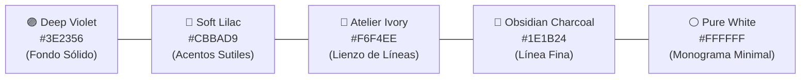
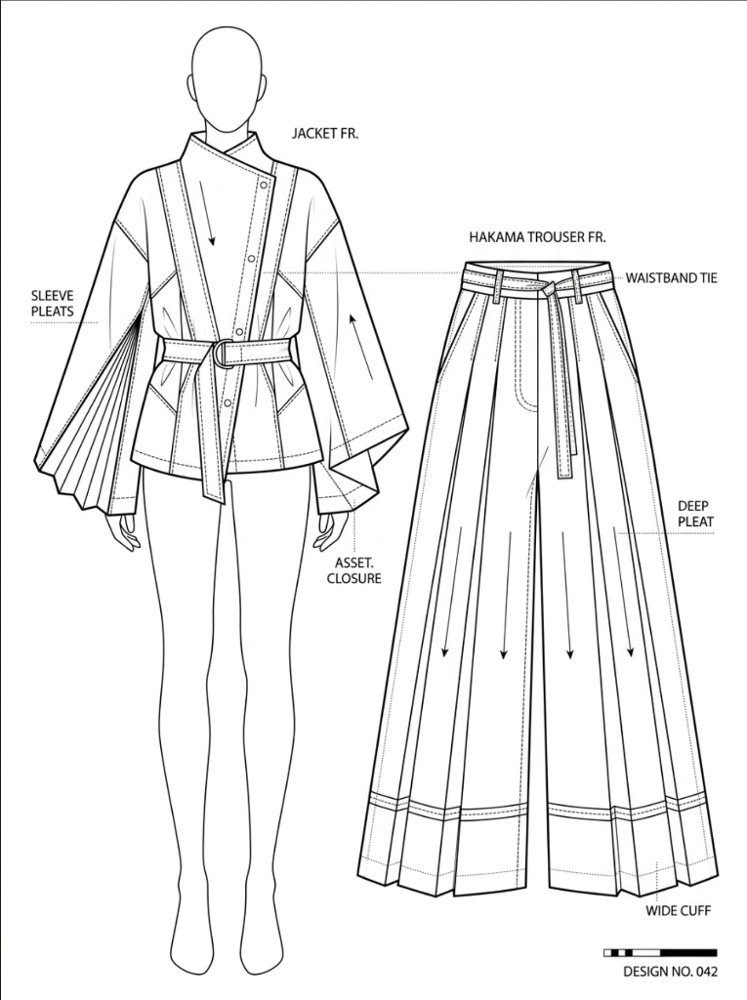

# Manual de Identidad Visual & Fuente de Estilo Artístico: Andreart Vestuario

*Guía Maestra de Dirección de Arte, Paleta Cromática, Tipografía, Minimalismo y Sistema de Prompts Visuales*  
*Location: 01 Brand Context / Brand Visual Style Guide*  
*Last updated: 2026-08-09*

> 🛡️ **Eslogan Oficial de Marca:** *"Sé tu propio héroe"*

---

## 📌 1. Principio Fundamental: Minimalismo de Autor & Aire Visual

La identidad visual de **Andreart Vestuario** se rige bajo la regla de **extrema limpieza visual, trazo suelto y generoso espacio negativo (aire visual)**. El lujo y la exclusividad de la alta costura residen en la simplicidad y en dejar respirar a la prenda, evitando saturaciones, fondos recargados o exceso de elementos en el encuadre.

```
┌────────────────────────────────────────────────────────────────────────────────────────┐
│                      REGLA DE ORO DE LIMPIEZA & MINIMALISMO                            │
├────────────────────────────────────────────────────────────────────────────────────────┤
│ • 50%+ Espacio Negativo: Fondos limpios y amplios (blanco marfil o morado liso).      │
│ • Trazo Suelto & Fluido: Líneas finas continuas y elegantes, sin garabatos densos.    │
│ • Cero Saturación: Sin exceso de textos, sin anotaciones amontonadas, sin adornos.    │
│ • Jerarquía Pura: Un solo elemento focal protagonista por slide.                      │
└────────────────────────────────────────────────────────────────────────────────────────┘
```

---

## 🎨 2. Paleta Cromática Oficial



| Color | Hex | RGB | Rol de Marca |
|---|---|---|---|
| **Deep Violet (Morado Real)** | `#3E2356` | `(62, 35, 86)` | Color maestro para fondos sólidos y slides de cierre. |
| **Soft Lilac (Lavanda Suave)** | `#CBBAD9` | `(203, 186, 217)` | Acentos sutiles, detalles luminosos y confort PAS. |
| **Atelier Ivory (Marfil Taller)** | `#F6F4EE` | `(246, 244, 238)` | Fondo amplio y limpio para figurines y croquis técnicos. |
| **Obsidian Charcoal (Negro Carbón)** | `#1E1B24` | `(30, 27, 36)` | Línea fina única para trazar siluetas deconstruidas. |
| **Pure White (Blanco Puro)** | `#FFFFFF` | `(255, 255, 255)` | Monograma geométrico de autor y textos minimalistas. |

---

## ✒️ 3. Logotipo & Monograma Oficial



- **Monograma:** Composición geométrica lineal con una 'A' central entrelazada en líneas diagonales y diamante invertido.
- **Tipografía:** Letras mayúsculas `A N D R E A R T` de trazo fino geométrico con interletrado generoso (*tracking amplio*).

---

## 👗 4. Dirección de Arte & Estilo de Figurín (Ficha Técnica CAD de Patronaje)



### Reglas de Diseño para el Slide 2 (Ficha Técnica CAD):
1. **Composición Dual de Alta Precisión:**
   - **Lado Izquierdo:** Maniquí/figura de moda estilizada vistiendo el conjunto completo con anotaciones de silueta.
   - **Lado Derecho:** Dibujo plano técnico vectorial (CAD Flat) de la prenda desglosada (pliegues profundos, costuras, pretinas, cierres, botas anchas).
2. **Línea Vectorial Nítida:** Trazo negro puro de alta definición sobre fondo blanco limpio (`#FFFFFF`), con flechas direccionales de caída de tela y líneas punteadas de costura.
3. **Anotaciones Técnicas en Mayúsculas:** Textos limpios con líneas guía indicadoras (`JACKET FR.`, `CROSSOVER CLOSURE`, `WAISTBAND TIE`, `DEEP PLEATS`, `WIDE CUFF`).
4. **Índice de Diseño:** Insignia técnica en la esquina inferior derecha (`DESIGN NO. 042`).

---

## 🤖 5. Sistema de Prompts & Generación de Imágenes (Motor Anti-Drift)

### 🌟 Tokens Positivos Obligatorios para Slide 2 (CAD Técnico):
```text
professional fashion technical flat drawing, CAD specification sheet, crisp black vector line art, pure white background, dual layout with stylized mannequin on left and flat garment pattern on right, precise tailoring seams, pleat direction arrows, neat uppercase callout annotations with leader lines, design index badge, haute couture blueprint
```

---

## 📸 6. Prompts Maestros por Tipo de Slide

### Slide 1: Portada Hero (Fotografía Limpia de Alto Impacto)
> **Prompt:** `High-fashion editorial vertical 4:5 portrait of a model wearing avant-garde [GARMENT], Andreart brand style, deep violet atmospheric studio lighting (#3E2356), soft lavender rim light (#CBBAD9), moody cinematic depth, uncluttered clean background, sharp focus, haute couture styling.`

### Slide 2: Figurín Técnico en Líneas (Ficha Técnica CAD de Patronaje)
> **Prompt:** `Professional fashion technical flat drawing and specification sheet of [GARMENT], in the exact artistic CAD style of the reference image, pure white background, crisp black vector line art. Left side shows a minimalist mannequin fashion figure wearing the ensemble. Right side shows the detailed technical flat drawing of the garment with seam lines, fabric drape arrows, and neat uppercase technical callout annotations with leader lines, and 'DESIGN NO. 042' at bottom right. High contrast, precise tailoring blueprints.`

### Slide 3: Planos Detalle & Confort PAS (Macro Textil Limpio)
> **Prompt:** `Professional macro photography of dark heavyweight luxury textile weave of [GARMENT] with soft lavender undertones (#CBBAD9), clean reinforced tailoring stitches, seamless printed tagless label, tactile comfort PAS, clean studio lighting, shallow depth of field, minimalist composition.`

### Slide 4: Slide de Conversión CTA (Ultra-Minimalista Oficial)
> **Prompt:** `Ultra-minimalist haute couture Instagram slide for Andreart, seamless flat solid deep royal violet background (#3E2356), vast empty negative space, perfectly centered clean white geometric Andreart logo monogram, minimal single-line elegant typography 'SÉ TU PROPIO HÉROE', clean refined luxury aesthetic, zero clutter, breathable and simple.`

---

## 🔄 Historial de Revisiones (Changelog)
- **v1.1 (2026-08-09):** Refuerzo del Principio de Extrema Limpieza Visual, Espacio Negativo (50%+) y Trazo Suelto/Simple para eliminar saturación y ruido en todos los slides.
- **v1.0 (2026-08-09):** Creación del Manual de Identidad Visual y Fuente de Estilo Artístico.
