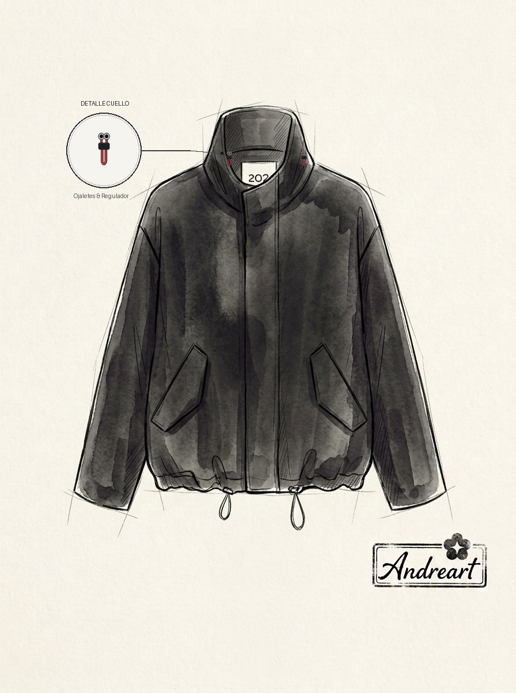
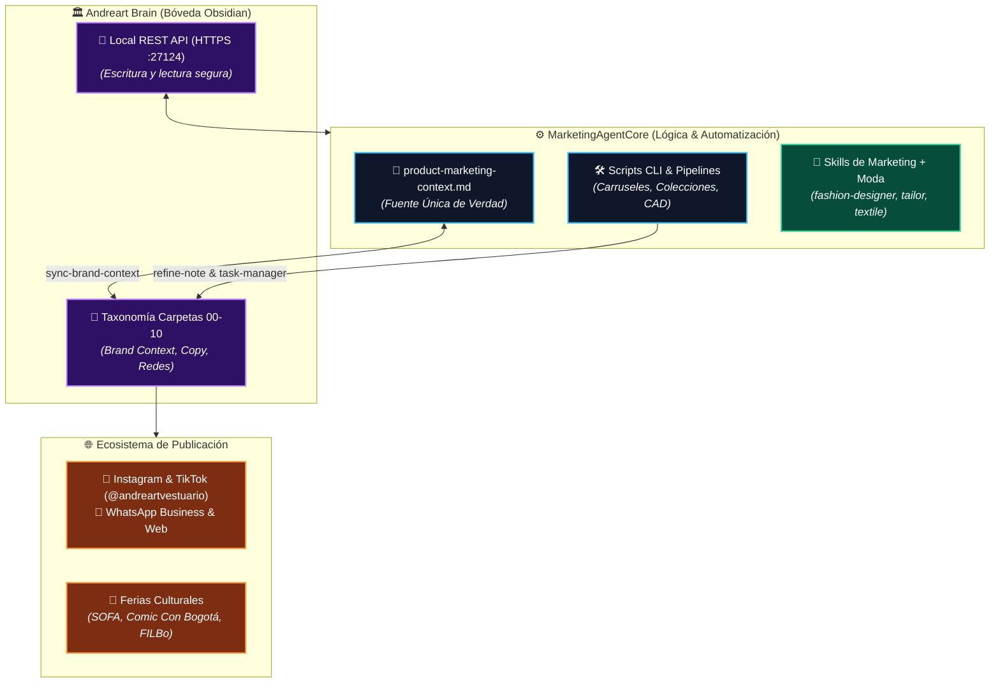

<div align="center">

# ⚔️ ANDREART VESTUARIO ⚔️
### *Urban Fantasy Haute Couture • Indumentaria Conceptual de Autor*

[](https://andreartvestuario.com)
[](https://andreartvestuario.com)
[](https://andreartvestuario.com)
[](https://andreartvestuario.com)

<br/>

[](file:///Andreart%20Brain)
[](http://localhost:27124)
[](MarketingAgentCore/scripts/enforce-compliance.sh)
[](MarketingAgentCore/context/product-marketing-context.md)
[](MarketingAgentCore/skills/)

<br/>

**Sistema integral de inteligencia de marketing, automatización editorial y base de conocimiento persistente para la firma de moda conceptual Andreart Vestuario.**

<br/>

| 📸 Instagram Principal | 🎵 TikTok Video | 💬 WhatsApp Business | 🌐 Tienda & Catálogo |
| :---: | :---: | :---: | :---: |
| [](https://www.instagram.com/andreartvestuario) | [](https://www.tiktok.com/@andreartvestuario) | [](https://wa.me/) | [](https://andreartvestuario.com) |

</div>

---

<p align="center">
  
  &nbsp;&nbsp;&nbsp;&nbsp;
  
</p>
<p align="center"><em>Bocetos conceptuales de autor y arquitectura de patronaje por Andrea (Directora Creativa)</em></p>

---

## 🏛️ 1. Sobre Andreart Vestuario

**Andreart Vestuario** es una firma de moda conceptual y sastrería de autor con base en Bogotá, Colombia, concebida y dirigida creativamente por **Andrea**. La marca traduce la fuerza estética y narrativa de universos fantásticos, literatura épica, cine, animación y ciencia ficción en indumentaria unisex estructurada, atemporal y versátil, diseñada para vestir con presencia y distinción tanto en la vida profesional y cotidiana (oficinas de IT, agencias, consultorios) como en escenarios y eventos culturales de gran formato.

> [!NOTE]
> **Filosofía de Autor:** Andrea deconstruye arquetipos visuales clásicos (magos, samuráis, guardianes, heroínas galácticas) mediante patronaje contemporáneo. Cada prenda está concebida para brindar una experiencia de distinción estética y porte heroico natural en el día a día.

### 🌟 Pilares de Identidad Textil
- ✂️ **Sastrería Conceptual de Autor:** Propuestas exclusivas creadas desde el dibujo, moldería y confección directa de su fundadora, garantizando autenticidad y acabados cuidados.
- 📐 **Moldería Inteligente Multitalla (XS a XL):** Sistema técnico de patronaje envolvente y ajustable, desarrollado para adaptarse con gracia anatómica a diversas siluetas sin distinciones de género.
- 🧵 **Calidad Textil y Caída Estructurada:** Selección rigurosa de tejidos de alto gramaje con caída pesada y acabados de alta costura, preparados para conservar porte y color a lo largo de los años.
- 🍃 **Confort Sensorial (Cuidado PAS):** Prendas adaptadas para personas con alta sensibilidad táctil (PAS), con marquillas estampadas no invasivas y uniones interiores de tacto suave.

> [!TIP]
> **Cuidado PAS Garantizado:** La ausencia de etiquetas rígidas cosidas y el cuidado en las costuras internas permiten que la prenda se use durante extensas jornadas de trabajo, convenciones o viajes con comodidad absoluta.

---

## 👘 2. Catálogo Insignia y Líneas de Producto

```text
ANDREART VESTUARIO
├── 🥋 PRENDA HÉROE
│   └── Pantalón Hakama Unisex (Silueta Guerrero Contemporáneo, adaptable XS a XL)
├── 🧥 CAPAS Y ABRIGOS EXTERIORES
│   ├── Capa de Mago Contemporáneo (Caída estructurada ligera)
│   ├── Capa Medieval de Invierno (Tejido envolvente de alta densidad)
│   ├── Sobretodo Épico de Guardián (Largo medio estructurado)
│   └── Manto Ceremonial de Orden Secreta
├── 🌸 LÍNEA ORIENTAL CONCEPTUAL
│   ├── Camisa Kimono Minimalista (Corte limpio contemporáneo)
│   ├── Haori Reinterpretado (Chaqueta ligera de líneas rectas)
│   └── Hanbok Contemporáneo (Siluetas fluidas de inspiración oriental)
└── 🚀 LÍNEA CIENCIA FICCIÓN & UNIVERSOS ESPECIALES
    ├── Conjunto Samurái Espacial (Fusión geométrica futurista)
    ├── Chaqueta Cazador de Criaturas (Estructura de porte sobrio)
    └── Vestido Minimalista Heroína Galáctica
```

### 📍 Puntos de Presencia y Eventos
- **Canales Digitales:** Instagram (`@andreartvestuario`), TikTok (`@andreartvestuario`), WhatsApp Business y tienda web oficial [`andreartvestuario.com`](https://andreartvestuario.com).
- **Eventos Culturales y Ferias de Gran Formato:** Presencia destacada en ferias como SOFA, Comic Con Bogotá, Feria Internacional del Libro de Bogotá (FILBo) y ferias de diseño local como Hecho en Bogotá.

---

## ⚡ 3. Arquitectura del Espacio de Trabajo

Este repositorio opera como el **sistema operativo de marketing y generación de activos editoriales asistido por agentes de IA**, manteniendo un desacoplamiento estricto entre el motor de lógica y la base de conocimiento:



### 📁 Mapa de Carpetas

```text
AndreArt Marketing Knowledge/
├── AGENTS.md                          # Reglas maestras, protocolos y estándares para agentes
├── README.md                          # Guía central embellecida del proyecto
├── MarketingAgentCore/                # Núcleo técnico, scripts, plantillas y skills
│   ├── context/                       # Fuente de verdad: product-marketing-context.md
│   ├── docs/                          # Manuales de flujos, taxonomía y activación
│   ├── imported-skills/               # 36 módulos upstream de referencia
│   ├── outputs/                       # Entregables técnicos intermedios
│   ├── scripts/                       # Suite de utilidades CLI (Bash, Node.js, Python)
│   ├── skills/                        # Skills adaptados a Andreart (marketing y moda)
│   ├── templates/                     # Plantillas YAML, notas de Obsidian y JSON
│   └── tests/                         # Suites de pruebas de idempotencia
├── Andreart Brain/                    # Bóveda de Obsidian (base de conocimiento activa)
│   ├── 00 Inbox/                      # Capturas rápidas, ideas y sesiones activas
│   ├── 01 Brand Context/              # Contexto de marca sincronizado y guías
│   ├── 02 Strategy & Research/        # Investigación de audiencias e ICPs
│   ├── 03 Website & Copy/             # Copys de producto, lookbooks y web
│   ├── 04 Email & Lifecycle/          # Secuencias de bienvenida, drops y comunidad
│   ├── 05 SEO & Discoverability/      # Estrategia de búsqueda y motores IA (GEO)
│   ├── 06 CRO & Funnel/               # Optimización de conversión en catálogo y chat
│   ├── 07 Paid, Social & Community/   # Publicaciones de Instagram/TikTok y carruseles
│   ├── 08 Analytics & Measurement/    # Medición, métricas y dashboards de impacto
│   ├── 09 Retention & Growth/         # Recompra y fidelización de coleccionistas
│   └── 10 RevOps & Sales/             # Ventas directas y logística para ferias
├── marketingskills/                   # Repositorio de referencia upstream
└── obsidian-agent-client/             # Plugin de Obsidian para integración con agentes
```

---

## 🛡️ 4. Protocolo Anti-Drift (5 Pasos)

Toda iniciativa editorial o técnica implementada por un agente sigue un protocolo riguroso para asegurar calidad, consistencia de voz y seguridad:

```mermaid
flowchart LR
    classDef gate fill:#1e1b4b,stroke:#818cf8,stroke-width:2px,color:#ffffff;
    classDef decomp fill:#312e81,stroke:#a78bfa,stroke-width:2px,color:#ffffff;
    classDef orch fill:#4c1d95,stroke:#c084fc,stroke-width:2px,color:#ffffff;
    classDef draft fill:#064e3b,stroke:#34d399,stroke-width:2px,color:#ffffff;
    classDef close fill:#831843,stroke:#f472b6,stroke-width:2px,color:#ffffff;

    A["🛡️ 1. Context Gate<br/><b>Validación Contexto Andreart</b>"]:::gate --> B["🧩 2. Descomposición<br/><b>Tareas Atómicas & Grafos</b>"]:::decomp
    B --> C["⚡ 3. Orquestación<br/><b>Workflows W1-W8 & Skills</b>"]:::orch
    C --> D["✍️ 4. Redacción Segura<br/><b>Bóveda Andreart Brain</b>"]:::draft
    D --> E["📊 5. Cierre & Métricas<br/><b>KPIs & Registro de Impacto</b>"]:::close
```



1. **Context Gate:** Lectura obligatoria de `MarketingAgentCore/context/product-marketing-context.md`. Prohibido inventar audiencias, precios o atributos fuera de la visión de Andreart.
2. **Descomposición Atómica:** División del objetivo en tareas secuenciales (`TASK-001`, `TASK-002`) con dependencias explícitas en formato JSON (`task-manager.sh`).
3. **Orquestación de Habilidades:** Selección de flujos (W1-W8) y skills locales (incluyendo habilidades textiles de diseño: `fashion-designer`, `tailor`, `textile-engineer`).
4. **Redacción Estructurada y Refinamiento No Destructivo:** Aplicación de `note-template.md` (YAML frontmatter, callout `> [!NOTE]`, wikilinks). Toda edición emplea snapshots de seguridad (`refine-note.sh`).
5. **Medición y Cierre:** Asignación de KPIs y eventos de seguimiento en el registro de sesión.

> [!IMPORTANT]
> **Estándar de Redacción (100% Lenguaje Afirmativo):** La propuesta de valor de Andreart se sostiene enteramente en la excelencia de sus materiales, su patronaje inteligente y su visión de autor. No se emplean comparaciones peyorativas hacia terceros ni expresiones de contraste negativo sobre disfraces o prendas desechables.

---

## 🛠️ 5. Suite de Scripts y Automatizaciones

El proyecto incluye herramientas CLI en `MarketingAgentCore/scripts/` para acelerar la creación de contenidos y asegurar la integridad del sistema:

| Categoría | Script | Comando Principal | Propósito |
| :---: | :--- | :--- | :--- |
|  | **`create-social-carousel.sh`** | `bash MarketingAgentCore/scripts/create-social-carousel.sh "<idea>" [img] [prenda] [ref]` | **Pipeline 4:5:** Genera carruseles con 4 diapositivas (Hero, Figurín Line-Art, Enfoque PAS, Conversión) y crea carpetas de activos en Obsidian. |
|  | **`create-social-post.sh`** | `bash MarketingAgentCore/scripts/create-social-post.sh <red> "<idea>" [tipo] [ref] [prenda]` | **Generador SOP:** Redacta posts con nomenclatura automática `YYYY-MM-DD-redsocial-idea.md`. |
|  | **`create-collection.sh`** | `bash MarketingAgentCore/scripts/create-collection.sh "<nombre>" [concepto] [prenda-heroe] [temporada] [paleta]` | **Colección Cápsula:** Estructura una colección completa con narrativa, prenda insignia y fichas técnicas. |
|  | **`generate-publication-assets.sh`** | `bash MarketingAgentCore/scripts/generate-publication-assets.sh <nota\|slug> [--input-image img]` | **Compositor CAD:** Extrae contornos de línea (line-art) y genera composiciones visuales para notas editoriales. |
|  | **`sync-content-grid.sh`** | `bash MarketingAgentCore/scripts/sync-content-grid.sh [audit\|sync\|update]` | **Master Content Grid:** Audita, sincroniza y mantiene al día la matriz central de contenidos. |
|  | **`task-manager.sh`** | `bash MarketingAgentCore/scripts/task-manager.sh <cmd>` | **Gestor de Tareas:** Control de sesiones (`init`, `list`, `add`, `update`, `show`, `close`) con seguimiento de dependencias. |
|  | **`refine-note.sh`** | `bash MarketingAgentCore/scripts/refine-note.sh <cmd>` | **Refinamiento Seguro:** Actualizaciones incrementales con snapshots de respaldo y changelog. |
|  | **`enforce-compliance.sh`** | `bash MarketingAgentCore/scripts/enforce-compliance.sh` | **Suite Anti-Drift:** Auditoría completa de Context Gate, Linter de Bóveda, Sesiones y Skills. |
|  | **`validate-context.sh`** | `bash MarketingAgentCore/scripts/validate-context.sh` | Comprueba la completitud del contexto de marca antes de comenzar redacciones. |
|  | **`validate-vault.sh`** | `bash MarketingAgentCore/scripts/validate-vault.sh` | Audita que los documentos cumplan kebab-case, carpetas 00-10 y propiedades YAML. |
|  | **`sync-brand-context.sh`** | `bash MarketingAgentCore/scripts/sync-brand-context.sh` | Sincroniza `product-marketing-context.md` con `Andreart Brain/01 Brand Context/`. |
|  | **`enable-project-skills.sh`** | `bash MarketingAgentCore/scripts/enable-project-skills.sh [--force]` | Vincula las skills locales hacia `~/.codex/skills/` para descubrimiento en tiempo de ejecución. |
|  | **`check-obsidian-api.sh`** | `bash MarketingAgentCore/scripts/check-obsidian-api.sh` | Verifica la API REST de Obsidian (HTTPS :27124) y valida la autenticación Bearer. |
|  | **`test-idempotency.sh`** | `bash MarketingAgentCore/tests/test-idempotency.sh` | Suite de pruebas de idempotencia y consistencia de datos en todo el sistema. |

<details>
<summary><b>💻 Ver comandos equivalentes para Windows PowerShell</b></summary>

```powershell
powershell -ExecutionPolicy Bypass -File .\MarketingAgentCore\scripts\create-social-carousel.ps1 <args>
powershell -ExecutionPolicy Bypass -File .\MarketingAgentCore\scripts\create-social-post.ps1 <args>
powershell -ExecutionPolicy Bypass -File .\MarketingAgentCore\scripts\create-collection.ps1 <args>
powershell -ExecutionPolicy Bypass -File .\MarketingAgentCore\scripts\generate-publication-assets.ps1 <args>
powershell -ExecutionPolicy Bypass -File .\MarketingAgentCore\scripts\sync-content-grid.ps1 <args>
powershell -ExecutionPolicy Bypass -File .\MarketingAgentCore\scripts\task-manager.ps1 <cmd>
powershell -ExecutionPolicy Bypass -File .\MarketingAgentCore\scripts\refine-note.ps1 <cmd>
powershell -ExecutionPolicy Bypass -File .\MarketingAgentCore\scripts\enforce-compliance.ps1
powershell -ExecutionPolicy Bypass -File .\MarketingAgentCore\scripts\validate-context.ps1
powershell -ExecutionPolicy Bypass -File .\MarketingAgentCore\scripts\validate-vault.ps1
powershell -ExecutionPolicy Bypass -File .\MarketingAgentCore\scripts\sync-brand-context.ps1
powershell -ExecutionPolicy Bypass -File .\MarketingAgentCore\scripts\enable-project-skills.ps1
powershell -ExecutionPolicy Bypass -File .\MarketingAgentCore\tests\test-idempotency.ps1
```
</details>

---

## 🎯 6. Los 8 Flujos de Trabajo de Marketing (W1 - W8)

| Flujo | Enfoque para Andreart | Skills Clave | Destino en Bóveda | Entregables Típicos |
| :---: | :--- | :--- | :--- | :--- |
|  | **Estrategia de Marca**<br/>Narrativa de colecciones, arquetipos e ICP | `mas-product-marketing-context`<br/>`mas-customer-research`<br/>`fashion-designer` | `01 Brand Context/`<br/>`02 Strategy & Research/` | `product-marketing-context.md`<br/>`brand-positioning-framework.md` |
|  | **Lookbooks y Copywriting**<br/>Páginas de producto insignia y catálogos | `mas-copywriting`<br/>`mas-copy-editing`<br/>`mas-page-cro` | `03 Website & Copy/`<br/>`06 CRO & Funnel/` | `hakama-product-page.md`<br/>`lookbook-capsula-noviembre.md` |
|  | **SEO & Posicionamiento IA (GEO)**<br/>Citación en motores de IA y búsqueda orgánica | `mas-seo-audit`<br/>`mas-ai-seo`<br/>`mas-schema-markup` | `05 SEO & Discoverability/` | `ai-seo-moda-conceptual.md`<br/>`guia-estilismo-hakama-urbano.md` |
|  | **Ciclo de Vida y Drops**<br/>Comunidad de coleccionistas y post-compra | `mas-cold-email`<br/>`mas-email-sequence`<br/>`mas-copy-editing` | `04 Email & Lifecycle/` | `secuencia-bienvenida-comunidad.md`<br/>`lanzamiento-drop-exclusivo.md` |
|  | **Contenido Social y Carruseles**<br/>Carruseles 4:5, reels y videos de confección | `mas-content-strategy`<br/>`mas-social-content`<br/>`mas-lead-magnets` | `07 Paid, Social & Community/`<br/>`02 Strategy/` | `carrusel-pantalon-hakama.md`<br/>`calendario-editorial-mes.md` |
|  | **Optimización de Conversión**<br/>Asesoría guiada por WhatsApp y tienda online | `mas-signup-flow-cro`<br/>`mas-onboarding-cro`<br/>`mas-ab-test-setup` | `06 CRO & Funnel/` | `flujo-asesoria-tallas-whatsapp.md`<br/>`cro-catalogo-digital.md` |
|  | **Ventas Directas y Ferias**<br/>Atención en stands (SOFA, Comic Con) y alianzas | `mas-sales-enablement`<br/>`mas-churn-prevention`<br/>`mas-revops` | `10 RevOps & Sales/`<br/>`09 Retention & Growth/` | `guia-argumentario-stand-sofa.md`<br/>`playbook-fidelizacion-clientes.md` |
|  | **Analítica y Medición**<br/>Rendimiento por colección, alcance y conversiones | `mas-analytics-tracking`<br/>`mas-ab-test-setup`<br/>`mas-revops` | `08 Analytics & Measurement/` | `scorecard-lanzamiento-capsula.md`<br/>`matriz-kpis-campana.md` |

---

## 🔮 7. Integración con Obsidian & Agente de IA

La base de conocimiento y los entregables residen en la bóveda:

- `Andreart Brain/`

### ⚙️ Características Técnicas
- **Obsidian Local REST API:** Activa en HTTPS en el puerto `27124` con autenticación por token Bearer para sincronización automatizada.
- **Obsidian Agent Client:** Plugin local preconfigurado en `Andreart Brain/.obsidian/plugins/agent-client/` para interactuar con agentes directamente desde la interfaz de notas.
- **Exportación de Sesiones:** Archivo ordenado de transcripciones en `Andreart Brain/00 Inbox/Agent Client Chats/`.

<details>
<summary><b>🛠️ Cómo recompilar el plugin Agent Client desde código fuente</b></summary>

```bash
cd obsidian-agent-client
npm install
npm run build
cp main.js manifest.json styles.css "../Andreart Brain/.obsidian/plugins/agent-client/"
```
</details>

---

## ✍️ 8. Estándares Editoriales de Andreart

Todo documento, post, copy o plan generado en este repositorio debe respetar estrictamente:

- 🟢 **100% Lenguaje Afirmativo:** La propuesta de valor de Andreart se sostiene en la nobleza de su sastrería conceptual, los textiles de alto gramaje y el diseño de autor. Se prohíben comparaciones peyorativas o frases de contraste negativo hacia disfraces, fast fashion o marcas masivas.
- 🎩 **Sobriedad y Madurez Estética:** Andreart representa alta costura conceptual para un público adulto que valora el diseño de autor. No se satura el texto con emojis decorativos; se emplean viñetas limpias (`•` o `-`).
- ⚡ **Conectores Directos y Breves:** Frases directas y contundentes antes de presentar beneficios o detalles técnicos de confección.
- 🎯 **Disciplina de Hashtags en Redes:** Máximo 4 a 5 hashtags estratégicos (Marca + Eslogan + Universo o Prenda clave), evitando listas kilométricas genéricas.
- 🔒 **Refinamiento Incremental No Destructivo:** Toda actualización sobre notas existentes preserva el conocimiento acumulado y documenta el historial de cambios en el changelog.

---

<div align="center">

**Andreart Vestuario • Bogotá, Colombia**  
*Sé tu propio héroe*

[](https://www.instagram.com/andreartvestuario)
[](https://www.tiktok.com/@andreartvestuario)
[](https://andreartvestuario.com)

</div>
